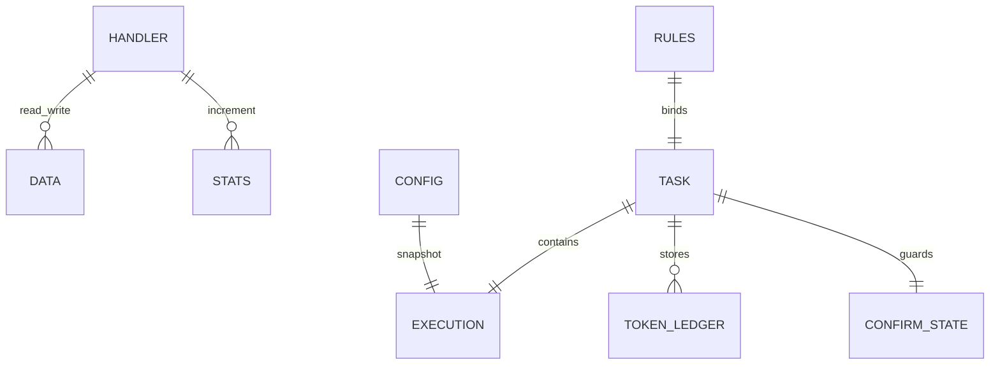

# 领域与数据模型总览

> 本仓数据分为四组：KV 内存字典、SOP 配置与规则快照、任务产物、Token 账本。ER 图只画真实存在的写入/读取关系；运行期产物在仓库快照中不存在，按现场缺失如实标注。配套阅读：[配置手册](../../contracts/configuration.md) · [KV 工作流](../kv-command-workflow.md)。

## 1. 实体关系

- `HANDLER` 为 `nosql.py:76-152` 的 8 个命令处理函数；`DATA` 与 `STATS` 均为模块级内存对象。
- `CONFIG` 是 `.wally/config.json`，`EXECUTION` 是建任务时生成的 `execution.json`。
- `RULES` 是 `.wally/install-state.json:4-5` 绑定的 revision 规则目录。
- `TOKEN_LEDGER` 与 `CONFIRM_STATE` 是运行期文件，当前仓库快照未包含。

## 2. KV 内存字典字段字典

| 实体 | 字段 | 类型 | 写入者 | 读取者 | 锚点 |
|---|---|---|---|---|---|
| `DATA` | `<key>` | 字符串键 → 字符串 / list / int | `handle_put` `nosql.py:79`、`handle_increment` `:121`、`handle_append` `:135` | `handle_get` `:89`、`handle_getlist` `:101`、`handle_increment` `:114`、`handle_append` `:128` | `nosql.py:47` |
| `DATA` | 删除语义 | `del DATA[key]` | `handle_delete` `nosql.py:147` | 后续 `GET` | `nosql.py:139-148` |
| `STATS` | 8 个命令键 × `success` | 整数 | `update_stats` `nosql.py:71` | `handle_stats` `nosql.py:152` | `nosql.py:12-45` |
| `STATS` | 8 个命令键 × `error` | 整数 | `update_stats` `nosql.py:73` | 同上 | `nosql.py:12-45` |

`STATS` 的 8 个命令键为 `PUT`、`GET`、`GETLIST`、`PUTLIST`、`INCREMENT`、`APPEND`、`DELETE`、`STATS`，与 `nosql.py:155-164` 的分派表键名一一对应。两者均为进程内对象，没有序列化出口。

## 3. SOP 配置与规则快照字段字典

| 文件 | 字段 | 当前值 | 写入者 | 读取者 |
|---|---|---|---|---|
| `.wally/config.json:2` | `schema` | `1` | 初始化流程 | `.wally/scripts/create_task.py:39` |
| `.wally/config.json:3-15` | `deploy` | command 空、guide 指向 test-env-deploy、readiness `pending`、4 条 gaps | 客户/初始化 | `.wally/scripts/create_task.py:41-52`、`.wally/scripts/sop_context.py:275-284` |
| `.wally/config.json:16-27` | `it` | command 空、guide 指向 integration_test、readiness `pending`、4 条 gaps | 客户/初始化 | 同上 |
| `.wally/install-state.json:2-7` | `schema` / `sop_version` / `revision` / `profile` / `steps` | `2` / `2.0` / `3f84e7245abcc75d` / `generic` / `6` | 初始化流程 | `.wally/scripts/create_task.py:83-94` |
| `.wally/install-state.json` | `docs` / `clients` | 7 个文档域 / 7 个客户端 | 初始化流程 | [认知边界](../../operations/boundary.md) |
| `.wally/install-state.json` | `managed_files` | 29 项路径 → SHA-256 | 初始化流程 | 升级校验，本 Wiki 不改写 |
| `.wally/install-state.json` | `language` / `language_basis` | `en` / README 正文不足 | 初始化流程 | `.wally/scripts/create_task.py:110` |

`.wally/profiles/project.md:8` 列出的技术文档路径中，`apis/`、`sqls/`、`unittest/`、`integration_test/`、`devops/` 为 SOP 权威页，本 Wiki 只链接。

## 4. 任务产物字段字典（运行期）

| 产物 | 字段 | 来源 | 说明 |
|---|---|---|---|
| `00-overview.md` | `Branch` / `分支` | 建任务时由 `--branch` 替换模板（`.wally/scripts/create_task.py:112`） | `.wally/scripts/sop_context.py:19` 的正则据此路由 |
| `00-overview.md` | `SOP Rules` / `SOP 规则` | 模板占位符替换为 `rule_root`（`.wally/scripts/create_task.py:64-65`、`:91`） | `.wally/scripts/sop_context.py:20` 据此绑定规则 |
| `00-overview.md` | `Current phase` | 阶段推进时人工更新 | `.wally/scripts/sop_context.py:48-52` 解析 |
| `execution.json` | `deploy` / `it` 全量字段 | `.wally/config.json` 的 JSON 快照（`.wally/scripts/create_task.py:114-115`） | 冻结当时的执行方法定义 |
| `01`–`06-*.md` | 六阶段正文 | `plans-template`（`.wally/scripts/create_task.py:56-66`） | 04/05 注入「执行状态」段（`:117-146`） |
| `token.json` | `requests[]` / `collection` | 采集器 `load_store` / `merge_store`（`.claude/hooks/_token_common.py:455-541`） | 报表 `load_requests`（`.claude/scripts/token_report.py:109-121`）读取 |
| `.wally/local/sop-confirmations.json` | `pending` / `approved` | `confirmation_state`（`.wally/scripts/sop_context.py:293-308`） | 字段 `scope`/`fingerprint`/`checkpoint`/`reason`/`token` |

上述运行期文件在当前仓库快照中不存在：`git ls-files` 未列出 `.wally/plans/` 与 `.wally/local/` 内容。本页只描述其由源码确定的结构，不伪造实际数据。

## 5. Token 账本字段字典

| 字段 | 类型 | 写入/归一 | 消费 |
|---|---|---|---|
| `client` / `source` | 字符串 | `record_client`（`.claude/scripts/token_report.py:175-182`）兜底早期 CodeBuddy 行 | `client_label`（`:154-167`） |
| `request_id` | 字符串 | 采集器写入 | claim 去重（`.claude/hooks/_token_common.py:570-602`） |
| `started_at` | 毫秒整数 | 采集器写入 | `format_time`（`.claude/scripts/token_report.py:124-134`） |
| `usage.input_tokens` 等 7 键 | 整数 | `normalize_usage`（`.claude/hooks/_token_common.py:293-360`） | `render`（`.claude/scripts/token_report.py:278-365`） |
| `usage.credit` | 浮点 | 同上 | Codex/Claude 行显示 `—`（`:320-321`） |
| `prompt` | 字符串 | 采集器写入 | `markdown_prompt` 转义后展示（`:137-147`） |
| `root_turn_id` / `thread_id` / `session_id` | 字符串 | 采集器写入 | `rollup_turns` 分组（`:195-230`） |
| `collection` | 字典 | 采集器状态 | `render_health`（`:368-398`） |

会计恒等式：`Total input = Uncached input + Cache read + Cache write`，`Tokens = Total input + Output`，推理 token 计入输出不重复计数（`.claude/scripts/token_report.py:354-362`）。

## 6. 写入归属与一致性边界

| 数据 | 唯一写入路径 | 一致性保证 |
|---|---|---|
| `DATA` | 5 个写函数（`nosql.py:76-136`、`:139-148`） | 单进程串行，无并发写 |
| `STATS` | `update_stats`（`nosql.py:67-73`） | 与 `DATA` 无事务，DELETE 成功路径会跳过统计 |
| `execution.json` | 建任务原子发布（`.wally/scripts/create_task.py:149-159`） | 与任务目录同时可见 |
| `token.json` | `file_lock` 串行写（`.claude/hooks/_token_common.py:396-441`） | 跨 Hook 进程互斥 |
| `00-overview.md` Token 区 | `patch_overview`（`.claude/scripts/token_report.py:415-425`） | 仅替换标记区，标记必须唯一 |

## 7. 共变耦合与修改清单（Co-Change Playbook）

1. 改 `DATA` 值类型：`nosql.py:50-64` → 本页第 2 节 → [线协议契约](../../integrations/downstream/socket-wire-protocol.md) → [KV 工作流](../kv-command-workflow.md)。
2. 改 `config.json` 字段：`.wally/config.json` → 本页第 3 节 → [配置手册](../../contracts/configuration.md) → [SOP 工作流](../sop-task-workflow.md)。
3. 改账本字段：`.claude/hooks/_token_common.py:293-360` → 本页第 5 节 → [IDE 接入层](../../architecture/ide-integration-hooks.md) → [可观测性 Runbook](../../operations/runbook-and-observability.md)。
4. 必跑验证：起服写入 `PUT; k; 7; INT` 后 `STATS;;;` 核对计数；`python3 -m py_compile` 覆盖 `.wally/scripts/` 与 `.claude/scripts/token_report.py`；核对本页所有 `source_paths` 在正文出现真实行号。
