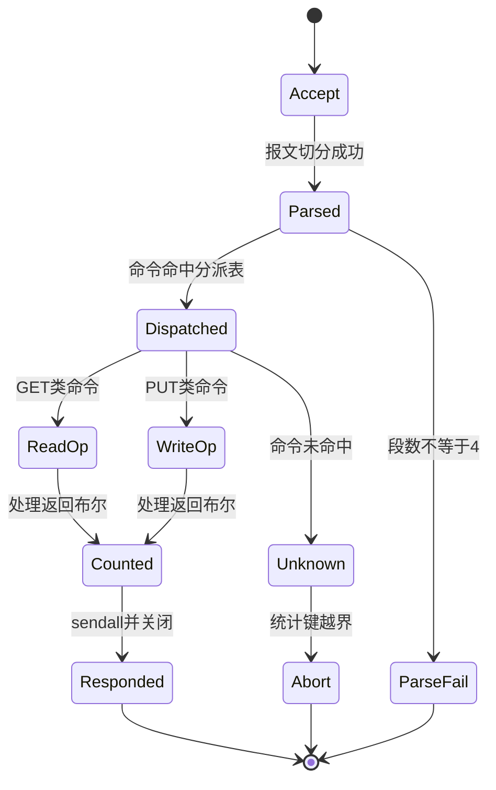

# KV 命令业务工作流（WF-KV-*）

> 本页锁定 8 个命令的业务规则与状态迁移，不重复描述函数实现细节。规则字面全部来自 `nosql.py:50-193`。引擎结构见 [nosql-engine](../architecture/nosql-engine.md)，报文字段见 [线协议契约](../integrations/downstream/socket-wire-protocol.md)。

## 1. 统一状态机

`Accept` 对应 `nosql.py:173` 的 `accept()`；`Parsed` 对应 `nosql.py:54-64`；`Dispatched` 对应 `nosql.py:179-189`；`Counted` 对应 `nosql.py:190`；`Responded` 对应 `nosql.py:191-193`。

## 2. 精确规则阈值表

| 规则编号 | 条件字面 | 成立时动作 | 否则动作 | 锚点 |
|---|---|---|---|---|
| R1 | 切分后段数 `== 4` | 进入类型转换 | 返回错误字符串 | `nosql.py:54-56` |
| R2 | `value_type == 'LIST'` | `value.split(',')` | 进入 R3 | `nosql.py:58-59` |
| R3 | `value_type == 'INT'` | `int(value)` | `value = None` | `nosql.py:60-63` |
| R4 | `command == 'STATS'` | `handle_stats()` 无参调用 | 进入 R5 | `nosql.py:179-180` |
| R5 | `command in ('GET','GETLIST','INCREMENT','DELETE')` | 单参 `handler(key)` | 进入 R6 | `nosql.py:181-182` |
| R6 | `command in ('PUT','PUTLIST','APPEND')` | 双参 `handler(key, value)` | 未知命令 | `nosql.py:183-189` |
| R7 | `key in DATA` | 读路径返回值 | 键不存在错误 | `nosql.py:86-89` |
| R8 | `isinstance(value, list)` | GETLIST 通过 | 非 list 错误 | `nosql.py:104-108` |
| R9 | `isinstance(value, int)` | INCREMENT 执行 `value + 1` | 非 int 错误 | `nosql.py:117-122` |
| R10 | `isinstance(list_value, list)` | APPEND 执行 `append(value)` | 非 list 错误 | `nosql.py:131-136` |
| R11 | `success` 为真 | `STATS[command]['success'] += 1` | `['error'] += 1` | `nosql.py:70-73` |

## 3. 各流程业务语义

| WF | 前置 | 业务效果 | 终态副作用 | 锚点 |
|---|---|---|---|---|
| WF-KV-PUT | 无 | 覆盖写 `DATA[key]` | 计数 +1 | `nosql.py:76-80` |
| WF-KV-GET | 键存在 | 读值，不改状态 | 计数 +1 | `nosql.py:83-89` |
| WF-KV-PUTLIST | 无 | 复用 PUT，不校验列表类型 | 计数 +1 | `nosql.py:92-95` |
| WF-KV-GETLIST | 键存在且值为 list | 读列表 | 计数 +1 | `nosql.py:98-108` |
| WF-KV-INCREMENT | 键存在且值为 int | `DATA[key] = value + 1` | 计数 +1 | `nosql.py:111-122` |
| WF-KV-APPEND | 键存在且值为 list | `DATA[key].append(value)` | 计数 +1 | `nosql.py:125-136` |
| WF-KV-DELETE | 键存在 | `del DATA[key]` | 成功路径无返回，统计阶段中断 | `nosql.py:139-148` |
| WF-KV-STATS | 无 | 返回 `str(STATS)` | 自身计数 +1 | `nosql.py:150-152` |

## 4. 失败与补偿语义

| 失败点 | 业务结果 | 是否可重试 | 补偿手段 |
|---|---|---|---|
| R1 切分失败 | 客户端无响应 | 否 | 客户端修正报文字段数后重连 |
| R9 非 int | 返回 `ERROR` 文案，数据不变 | 是 | 先用 `PUT; k; 1; INT` 写入整数 |
| R10 非 list | 返回 `ERROR` 文案，数据不变 | 是 | 先用 `PUTLIST; k; a,b; LIST` 写入列表 |
| R7 键缺失 | 返回 `Error: Key ... not found` | 是 | 先写入键 |
| DELETE 成功 | 数据已删但连接抛 `TypeError` | 否 | 再发 `GET` 可确认键已不存在 |
| 未知命令 | 抛 `KeyError` | 否 | 仅使用分派表内 8 个命令 |

无事务、无回滚、无幂等令牌：所有写操作即时生效于内存字典。进程重启后 `DATA` 与 `STATS` 同时丢失，彼此不保证一致恢复。

## 5. 业务不变量

1. `COMMAND_HANDERS` 的 8 个键与 `STATS` 的 8 个键必须同名（对照 `nosql.py:155-164` 与 `nosql.py:12-45`），否则统计阶段越界。
2. `PUTLIST` 与 `PUT` 共用同一写入路径（`nosql.py:92-95`），不能用它保证值类型为列表。
3. `INCREMENT` 的成功文案使用自增前的值（`nosql.py:122`），不反映存储最终结果。
4. 一次 `recv` 对应一次命令（`nosql.py:177-178`），超出 4096 字节的报文无法正确解析。

## 6. 共变耦合与修改清单（Co-Change Playbook）

1. 改 R5/R6 命令归类：`nosql.py:179-189` → 本页第 2/3 节 → [API 参考](../contracts/api-reference.md) → [引擎实现](../architecture/nosql-engine.md)。
2. 改类型校验：`nosql.py:98-136` → [错误码字典](../contracts/error-codes.md) → [线协议契约](../integrations/downstream/socket-wire-protocol.md)。
3. 改计数规则：`nosql.py:67-73` → [数据模型](domain-models/index.md) → [可观测性 Runbook](../operations/runbook-and-observability.md)。
4. 必跑验证：起服后依次发送 `PUT; n; 5; INT`、`INCREMENT; n;;`、`GET; n;;`、`PUTLIST; l; a,b; LIST`、`APPEND; l; c; LIST`、`GETLIST; l;;`、`STATS;;;`，核对每条响应与 `STATS` 最终计数。
