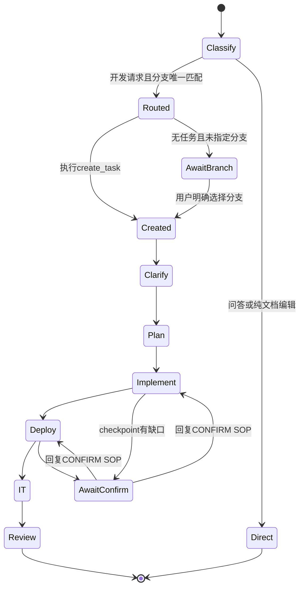

# SOP 任务工作流（WF-SOP-* 与 WF-TOKEN-*）

> 本页描述六阶段任务的创建、路由、门槛、确认与 Token 计量业务规则。实现函数结构见 [sop-tooling](../architecture/sop-tooling.md)，规则正文见不可变快照 `.wally/versions/3f84e7245abcc75d/core/workflow.md`。配套阅读：[业务架构](../overview/business-architecture.md)。

## 1. 任务生命周期状态机

`Classify` 规则见 `.wally/core/scope.md:1-3`；`Routed` 见 `.wally/scripts/sop_context.py:87-173`；`Created` 见 `.wally/scripts/create_task.py:69-161`；阶段顺序见 `.wally/versions/3f84e7245abcc75d/core/workflow.md:26-54`。

## 2. 创建期业务规则

| 规则 | 字面条件 | 失败结果 | 锚点 |
|---|---|---|---|
| 名称格式 | `^\d{4}-\d{2}-\d{2}_[\w.-]+$` 且不以点结尾 | `ValueError` | `.wally/scripts/create_task.py:71-72` |
| 日期真实 | `datetime.strptime(name[:10], "%Y-%m-%d")` | `ValueError` | `.wally/scripts/create_task.py:73` |
| 分支合法 | 非空、不含 `|` 反引号换行、非 main/master/HEAD | `ValueError` | `.wally/scripts/create_task.py:74-75` |
| 翻译未完成 | `install-state.translation_sources` 非空 | 拒绝建任务 | `.wally/scripts/create_task.py:84-85` |
| 初始化完成 | `schema == 2` 且 `steps == 6` | 拒绝建任务 | `.wally/scripts/create_task.py:86-87` |
| revision 合法 | 16 位小写十六进制 | 拒绝建任务 | `.wally/scripts/create_task.py:88-90` |
| 规则齐全 | 4 个绑定 core 文件存在 | 拒绝建任务 | `.wally/scripts/create_task.py:92-94` |
| 任务唯一 | 目录不存在且 Branch 字段不重复 | 拒绝建任务 | `.wally/scripts/create_task.py:96-104` |
| 配置合法 | schema 1、字段类型与 readiness 域正确 | 拒绝建任务 | `.wally/scripts/create_task.py:114`、`:26-53` |

`.wally/scripts/create_task.py:57-58` 强制 `steps == 6`，模板少于或多于六阶段一律拒绝。任务目录经临时目录写全后 `rename` 原子发布（`:150-159`）。

## 3. 路由与阶段门槛规则

| 规则 | 判定 | 结果 | 锚点 |
|---|---|---|---|
| 分支存在 | `git branch --show-current` 非空 | 否则 `ValueError`，见 [git 子进程契约](../integrations/downstream/git-subprocess.md) | `.wally/scripts/sop_context.py:90-95` |
| 唯一匹配 | 恰好 1 条 overview 的 Branch 字段相等 | 0 条给建任务指引；多条阻断 | `.wally/scripts/sop_context.py:105-114` |
| 规则绑定 | 路径匹配 `.wally/versions/[0-9a-f]{16}/core` | 否则拒绝，不用最新规则兜底 | `.wally/scripts/sop_context.py:130-132` |
| 阶段一致 | 文件名前缀与 Phase 编号一致 | 否则要求修复 overview | `.wally/scripts/sop_context.py:139-143` |
| Implement 前置 | 01/02 标记完成且正文与模板不同 | 否则生成 confirm issue | `.wally/scripts/sop_context.py:267-274` |
| Deploy/IT 前置 | `method_configured` 为真 | 否则生成 confirm issue | `.wally/scripts/sop_context.py:275-284` |

`checkpoint_issue` 生成 `scope` 与 SHA-256 `fingerprint`（`.wally/scripts/sop_context.py:287-288`）。`require_confirmation` 写 pending 并返回 12 位 token（`:325-345`）；`accept_confirmation` 在 token、scope、fingerprint 三者一致时移入 approved（`:348-366`）。

## 4. 执行方法的三值语义

| `readiness` | command/guide | 任务状态 | 能否自动跳过 | 锚点 |
|---|---|---|---|---|
| `pending` | 有 guide 无 command | BLOCKED | 否，须索取缺口 | `.wally/config.json:8-14`、`.wally/scripts/create_task.py:120` |
| 空 | 两者皆空 | SKIPPED | 是，决策时间写零时长行 | `.wally/scripts/create_task.py:137-143` |
| 空 | 任一非空 | PENDING | 否，进入阶段时执行 | `.wally/scripts/create_task.py:119-122` |
| `ready` | 必须非空，否则配置校验失败 | PENDING | 否 | `.wally/scripts/create_task.py:46-52` |

本仓 deploy 与 it 均为第一种：`command` 空、`guide` 指向 SOP 文档、`readiness: pending`、各 4 条 `gaps`。因此当前生成的任务将标记 BLOCKED，而非 SKIPPED。

**关键不变量**：SKIPPED 不是 PASS。`.wally/versions/3f84e7245abcc75d/core/gates.md:23-36` 明确未配置环境验证不得声称端到端通过；确认例外只放行缺口，不把未验证阶段标记为完成。

## 5. Token 计量业务规则

| 规则 | 条件 | 动作 | 锚点 |
|---|---|---|---|
| 分支开关 | main、master、release 或 release/ 前缀 | 跳过汇总，退出 0 | `.claude/scripts/token_report.py:58-62` |
| 轮次粒度 | Cursor 一轮一 `generation_id` | 不再二次求和 | `.claude/scripts/token_report.py:206-208` |
| Codex 分组 | thread + root_turn_id + agent_kind + agent_type + session | 同组求和 | `.claude/scripts/token_report.py:209-224` |
| CodeBuddy 分组 | 同会话连续同 prompt | 合并为一行 | `.claude/scripts/token_report.py:185-192` |
| 会计恒等式 | 总输入 = 未缓存 + 缓存读 + 缓存写 | 固定写死在报告脚注 | `.claude/scripts/token_report.py:354-362` |
| 缺失语义 | 无记录或采集失败 | 不写零用量，写告警 | `.claude/scripts/token_report.py:396-397`、`:466-467` |

## 6. 时间日志与交付门槛

`.wally/versions/3f84e7245abcc75d/core/gates.md:38-52` 要求新任务 overview 恰有 01–06 六行：完成阶段需起止秒、时长、轮次与 Progress 一致；自动跳过的 Deploy/IT 保留创建时决策时间、0 秒、0 轮并注明未执行；无证据的补录阻断 Commit。Review 阶段还需执行 Token 汇总并检查 Docs 核验结果。

## 7. 共变耦合与修改清单（Co-Change Playbook）

1. 改阶段定义：`.wally/versions/3f84e7245abcc75d/core/workflow.md:26-54` → 本页第 1 节 → [业务架构](../overview/business-architecture.md) → [API 参考](../contracts/api-reference.md)。
2. 改执行方法判定：`.wally/scripts/create_task.py:20-53` → 本页第 4 节 → [配置手册](../contracts/configuration.md) → [错误码字典](../contracts/error-codes.md)。
3. 改确认流程：`.wally/scripts/sop_context.py:293-366` → 本页第 3 节 → [排障 Runbook](../operations/runbook-and-observability.md)。
4. 改 Token 口径：`.claude/scripts/token_report.py:195-230` → 本页第 5 节 → [IDE 接入层](../architecture/ide-integration-hooks.md) → [认知边界](../operations/boundary.md)。
5. 必跑验证：`python3 .wally/scripts/sop_context.py --checkpoint implement`；`python3 .wally/scripts/sop_context.py --hook --client codebuddy --event UserPromptSubmit` 输入空 JSON；核对 `.wally/config.json:8-14` 与 `.wally/install-state.json:2-7` 的 pending / revision 状态与本页第 4 节一致。
