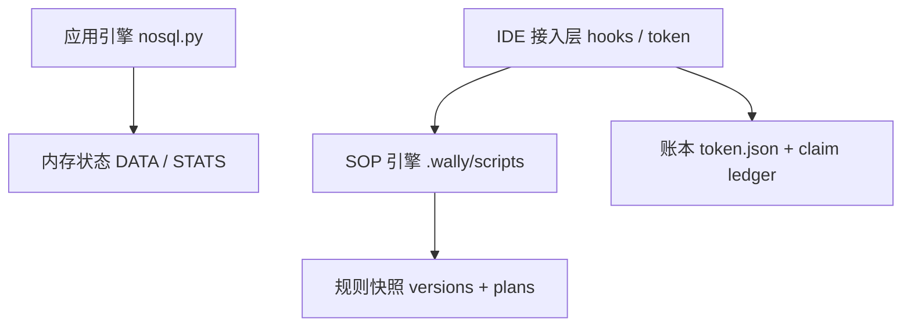

# 系统技术架构全景

> 本仓为 `hands-on-learning` 单仓：一个独立 Python TCP 键值服务，外加一套治理开发流程的 SOP 脚本与 IDE Hook 工具链。两条执行链之间没有调用边，唯一共享机制是「仓库根路径发现」。配套阅读：[业务架构全景](business-architecture.md) · [组件总表](../architecture/index.md)。

## 1. 分层拓扑与红线



| 层 | 载体 | 进程形态 | 不可越过的红线 |
|---|---|---|---|
| L1 应用引擎 | `nosql.py:167-193` (`main`) | 长驻单进程，阻塞式 TCP 接受循环 | 状态只在 `DATA`（`nosql.py:47`）与 `STATS`（`nosql.py:12-45`）中，进程退出即丢失 |
| L2 SOP 引擎 | `.wally/scripts/create_task.py:69-161` (`create`)、`.wally/scripts/sop_context.py:87-173` (`route`) | 短命 CLI 进程 / Hook 进程 | 规则来自不可变快照 `.wally/install-state.json:2-6`，禁止回退到「最新版本」兜底 |
| L3 IDE 接入层 | `.claude/hooks/_token_common.py:396-441` (`file_lock`)、`.claude/scripts/token_report.py:428-482` (`main`) | 由编辑器事件触发，3–5 秒超时 | Hook 失败不得变成全局工具禁止；采集缺失不得被当作零用量 |
| L4 规则与知识资产 | `.wally/versions/3f84e7245abcc75d/core/workflow.md:1-66` | 纯 Markdown，无执行体 | CodeWiki 只维护本页集；`apis/`、`sqls/`、`unittest/`、`integration_test/`、`devops/` 归 SOP 权威页所有 |

## 2. 启动装配调用树

```text
[应用引擎] python3 nosql.py -> nosql.py:167 main()
  ├─ nosql.py:169-170 SOCKET.bind((HOST, PORT)) -> SOCKET.listen(1)
  ├─ nosql.py:172 while 1 -> SOCKET.accept() -> 单连接串行处理
  ├─ nosql.py:177-178 recv(4096).decode() -> parse_message(data)
  └─ nosql.py:179-193 分派 -> update_stats -> sendall -> close

[任务创建] .wally/scripts/create_task.py:164 main()
  ├─ .wally/scripts/create_task.py:171 create(root, name, branch)
  │   ├─ .wally/scripts/create_task.py:83-94 读 install-state + 校验 4 个绑定规则文件
  │   ├─ .wally/scripts/create_task.py:114 execution_config(root) -> 校验 .wally/config.json:2 schema 1
  │   ├─ .wally/scripts/create_task.py:117-146 为 deploy/it 注入执行状态段落
  │   └─ .wally/scripts/create_task.py:150-159 临时目录写盘 -> staged.rename(task) 原子发布
  └─ .wally/scripts/create_task.py:172-173 捕获 OSError/ValueError/KeyError -> parser.exit(1)

[上下文路由] .wally/scripts/sop_context.py:394 main()
  ├─ .wally/scripts/sop_context.py:409 route(root)
  │   ├─ .wally/scripts/sop_context.py:90-95 git branch --show-current -> 无分支即阻断
  │   ├─ .wally/scripts/sop_context.py:97-114 匹配唯一 00-overview.md -> 否则给建任务指引
  │   └─ .wally/scripts/sop_context.py:130-173 解析 rules 路径与当前阶段 -> 组装 documents
  └─ .wally/scripts/sop_context.py:416-461 checkpoint/hook 双出口 -> JSON 或纯文本
```

## 3. 跨切面机制

| 机制 | 实现锚点 | 不变量 |
|---|---|---|
| 路径包含校验 | `.wally/scripts/create_task.py:11-17` (`is_relative_to`)、`.wally/scripts/sop_context.py:62-77` (`inside`) | 所有解析后的路径必须落在仓库根内，越界即 `ValueError` |
| 配置只读 | `.wally/scripts/create_task.py:26-53` (`execution_config`) | 校验 `schema == 1`、`readiness` 三值域、字段类型；不执行也不推断客户命令 |
| 原子发布 | `.wally/scripts/create_task.py:150-159` | 先在 `TemporaryDirectory` 写全，再 `staged.rename(task)` 一次性暴露任务目录 |
| 并发与去重 | `.claude/hooks/_token_common.py:396-441` (`file_lock`)、`.claude/hooks/_token_common.py:570-602` (`record_claims`) | 账本写入串行化；同一请求 ID 只计一次 |
| 截止时间 | `.claude/hooks/_token_common.py:106-141` (`install_deadline`) | Hook 超时后主动停止，避免拖住编辑器 |
| 分支级开关 | `.claude/scripts/token_report.py:58-62` (`token_work_disabled`) | `main`、`master`、`release*` 分支跳过 Token 汇总 |
| 写入边界 | `.wally/scripts/sop_context.py:369-391` (`check_tool`) | 仅 `edit` 类工具被审视；纯文档路径与任务目录内改动直接放行 |

## 4. 进程、网络与磁盘边界

- 网络：`nosql.py:9-11` 固定 `localhost:50505` / `AF_INET` / `SOCK_STREAM`，无配置覆盖、无 TLS、无鉴权，仅适合本机学习用途。
- 子进程：`.wally/scripts/sop_context.py:90-92` 调 `git -C <root> branch --show-current`（3 秒超时）；`.claude/scripts/token_report.py:401-412` 调 Codex 采集器 `--refresh-task`（10 秒超时）。两者是精确的契约边界，详见 [git 子进程下游契约](../integrations/downstream/git-subprocess.md)。
- 磁盘：`.wally/plans/` 存任务，`.wally/versions/` 存不可变规则，`.wally/local/` 存确认状态与 Token 账本；运行期目录树见 [部署与运行时](../operations/deployment-and-runtime.md)。

## 5. 共变耦合与修改清单（Co-Change Playbook）

1. 改引擎网络常量：`nosql.py:9-11` → `architecture/nosql-engine.md` → `contracts/configuration.md` → `operations/deployment-and-runtime.md`。
2. 改任务目录结构：`.wally/scripts/create_task.py:95-159` → `.wally/scripts/sop_context.py:97-151` → `business/sop-task-workflow.md` → `business/domain-models/index.md`。
3. 改账本字段：`.claude/hooks/_token_common.py:443-541` → `.claude/scripts/token_report.py:278-365` → `architecture/ide-integration-hooks.md` → `operations/runbook-and-observability.md`。
4. 必跑验证：`python3 -m py_compile nosql.py .wally/scripts/create_task.py .wally/scripts/sop_context.py`；另起终端 `python3 nosql.py` 后逐条发送 8 个命令核对响应；`python3 .wally/scripts/sop_context.py` 观察当前分支路由输出。
